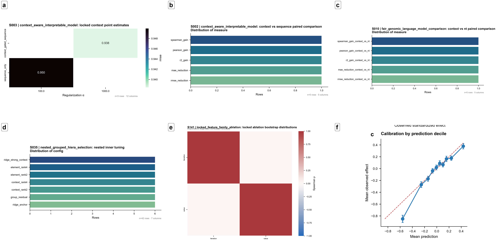

# HIERA-VEP

Interpretable context-gated regulatory variant-effect prediction from sequence and genomic annotations.

HIERA-VEP is a model-development research study addressing how regulatory single-nucleotide substitutions change assay-measured activity, and whether genomic context improves a transparent sequence model. The released predictor is a locked context-gated Ridge model with exact additive block contributions.

## Study design and scale

The unified study comprises **36,188 variants**, including **29,444 development** and **6,744 external** variants across **31 assay groups**, **28 regulatory elements**, and **15 context groups**. Source: [`hiera_unified_table_summary.json`](results/locked/hiera_unified_table_summary.json). Nested grouped selection and position/sequence grouping were used to reduce leakage. The locked internal test contains **4,408 variants** in **1,476 position clusters**, as recorded in [`calibration_uncertainty_failure_summary.json`](results/locked/calibration_uncertainty_failure_summary.json).

The locked test was not used for model selection or preprocessing. Development train+validation statistics were saved before deployment and are reused without recalculation. Public packaging preserves the final model and does not retrain or modify reported scientific results.

## Model architecture

For reference and alternative sequences, define Δk = count(alternative) − count(reference) for character k-mers of lengths 3–6. The saved vectorizer has **5,440** vocabulary entries. The 12 context features encode cCRE/promoter overlap, transformed TSS distance, continuous conservation scores, conservation flags, and cCRE class indicators. Three continuous features use saved development-pool standardization.

The model is

$$\hat y=b+\beta_s^T\Delta k+\beta_c^Tc+\sum_{g\in G}\beta_g^T(\Delta k\,c_g),$$

where $G$ is cCRE overlap, promoter overlap, phyloP100way, and phastCons100way, in that order. Conservation gates use standardized context values. The sequence block, 12 context values, and four sequence-by-context blocks yield **27,212** features. Selected Ridge **alpha = 1000**. Feature order and preprocessing are authoritative in [`preprocessing_spec.json`](models/preprocessing_spec.json); selection is documented in [`context_model_summary.json`](models/context_model_summary.json).

## Locked internal results

Exact source: [`locked_context_point_estimates.tsv`](results/locked/locked_context_point_estimates.tsv). Displayed numbers are rounded, with full precision retained in that TSV.

| Model | MAE | RMSE | R² | Pearson r | Spearman ρ | Direction accuracy | Observed SD | Predicted SD |
|---|---:|---:|---:|---:|---:|---:|---:|---:|
| context_selected | 0.606729 | 0.938429 | 0.116202 | 0.351530 | 0.291783 | 0.602995 | 0.998330 | 0.274342 |
| sequence_only | 0.621664 | 0.949950 | 0.094368 | 0.310379 | 0.285396 | 0.593693 | 0.998330 | 0.339405 |

The position-cluster paired comparison gives an RMSE reduction of **0.011521** (95% CI **0.003786–0.019284**, bootstrap P **0.004**) and Pearson gain of **0.041152** (95% CI **0.016651–0.064709**, P **0.001**). Source: [`context_vs_sequence_paired_comparison.tsv`](results/locked/context_vs_sequence_paired_comparison.tsv). Spearman gain is not supported by its interval; see the same file. These modest gains do not imply universally reliable predictions.

## External validation and interpretation

Zero-shot transfer is weak and heterogeneous, with near-zero or negative R² across several tiers and no consistent advantage over Ridge. See [`external_validation_point_estimates.tsv`](results/external/external_validation_point_estimates.tsv), [`frozen_nt_external_point_estimates.tsv`](results/external/frozen_nt_external_point_estimates.tsv), and [`locked_external_point_estimates.tsv`](results/external/locked_external_point_estimates.tsv). Earlier neural HIERA candidates and their external analyses are historical comparisons; they must not be confused with the released context-gated Ridge. Assay adaptation and few-shot learning use target-assay labels and are **secondary analyses**, not zero-shot generalization.

Inference reports the intercept, sequence main effect, additive context contribution, and four gated sequence contributions. Their sum reconstructs the prediction within floating-point tolerance. This is an exact model explanation, not a causal decomposition of biology. See [`attribution_counterfactual_summary.json`](results/interpretation/attribution_counterfactual_summary.json).

## Known limitations

External zero-shot transfer was weak and heterogeneous; external R² values were around zero or negative across several tiers. HIERA-VEP did not consistently outperform Ridge externally. Assay-specific adaptation is a secondary analysis requiring target-assay labels and is not zero-shot generalization.

Predicted effects were compressed relative to observed effects, and large-effect variants were a major failure mode. Model disagreement is only an uncertainty proxy, not a calibrated predictive interval.

Position-level motif enrichment did not yield broadly FDR-supported motifs (zero significant position-level motifs in `results/interpretation/motif_conservation_validation_summary.json`). Exact significant GTEx overlap was extremely sparse: one variant/position in `results/interpretation/gtex_eqtl_concordance_summary.json`. Absence of an overlap is not evidence of absent regulatory activity.

Conservation and motif analyses are concordance or computational annotation, not causal validation. Conservation was itself a model input, so attribution–conservation agreement is not independent validation. Earlier Step 53A language deferring eQTL analysis is retained as historical provenance; Step 53B provides the subsequent sparse exact-match analysis.

The software is research-only and is not a clinical pathogenicity classifier. No universal generalization, experimental validation, or causal interpretation is claimed.

## Installation and hardware

Use **Python 3.11**. In a fresh environment:

```bash
python -m pip install -r requirements.txt
python -m pytest -q
```

Inference is CPU-only and requires no GPU or pretrained language-model download. Memory scales with batch size. Critical compatibility versions include NumPy 2.4.6, pandas 2.3.3, and scikit-learn 1.9.1, matching serialized model compatibility. Optional scientific/plotting and Nucleotide Transformer dependencies are in `requirements-analysis.txt` (including Biopython 1.88 and PyTorch 2.5.1). Those comparisons may require a GPU and externally retrieved pretrained weights. See [installation](docs/INSTALLATION.md).

## Batch scoring

Run from the repository root:

```bash
python src/hiera_vep_score.py --bundle . --input examples/example_scoring_input.tsv --output examples/example_predictions.tsv
```

Inputs require `reference_sequence`, `alternative_sequence`, `ccre_overlap`, `promoter_overlap`, `absolute_distance_to_nearest_tss`, `phyloP100way`, `phastCons100way`, `phyloP_conserved`, `phyloP_accelerated`, `phastCons_high`, and `primary_ccre_class`. The sequences must have equal lengths and exactly one changed nucleotide; cCRE classes must be `none`, `PLS`, `pELS`, `dELS`, or `CA-H3K4me3`. Missing required annotations are rejected. See the complete [data dictionary](docs/DATA_DICTIONARY.md) and [example](examples/README.md).

Outputs preserve input columns and include `hiera_vep_prediction`, seven exact contribution blocks, `reconstructed_prediction`, and absolute `reconstruction_error`. The scorer fails if assets are missing or ambiguous, dimensions are wrong, or additivity error reaches 1e-5. Predictions are standardized assay effects, not pathogenicity probabilities.

## Repository organization

| Path | Contents |
|---|---|
| src/hiera_vep_score.py | Portable locked batch scorer |
| src/analysis | Preserved historical scientific scripts with portability corrections |
| src/figures | Final figure-generation/assembly scripts |
| models | Locked Ridge, vectorizer, coefficients, scaling specification and manifest |
| examples / tests | Original release example, reference predictions and validation |
| results | Summary locked, external and interpretation evidence |
| figures | Selected original manuscript PNGs |
| docs | Model card, reproducibility, provenance, workflow and limitations |
| data/README.md | Public data sources and reconstruction policy |
| HIERA_VEP_COMPLETE_CODE.py | Self-extracting complete Python source bundle |

## Reproducibility

```bash
python -m pytest -q
python -m compileall -q src HIERA_VEP_COMPLETE_CODE.py
python HIERA_VEP_COMPLETE_CODE.py --list
python HIERA_VEP_COMPLETE_CODE.py --extract extracted_source
```

Check [REPRODUCIBILITY.md](docs/REPRODUCIBILITY.md), [ANALYSIS_WORKFLOW.md](docs/ANALYSIS_WORKFLOW.md), and [RESULT_PROVENANCE.md](docs/RESULT_PROVENANCE.md). Inference is self-contained; full historical analyses require excluded public inputs and upstream intermediates. Existing manuscript composites require their upstream panel archives for reassembly. No raw dataset, bulk variant table, foundation weights, deployment app, or manuscript draft is included.

## Selected manuscript figures



All five main figures and selected supplementary figures are indexed in [figures/README.md](figures/README.md), with original caption and panel provenance. These are existing manuscript images and were not regenerated during packaging.

## Data acknowledgements, citation and license

The study uses public MaveDB regulatory assays, ENCODE cCREs, GENCODE/TSS annotations, UCSC conservation tracks, JASPAR motifs, GTEx eQTL annotations, and a Nucleotide Transformer comparator. Source access and reconstruction instructions are in [data/README.md](data/README.md). All external datasets and weights retain their original licenses and terms; they are not relicensed by this repository.

Project code is released under the [MIT License](LICENSE). [CITATION.cff](CITATION.cff) contains a clearly marked **HIERA-VEP contributors** placeholder pending authoritative final author and manuscript metadata. No DOI, final manuscript citation, affiliation, or email is asserted. Please cite the software repository/version until final metadata are supplied.

For questions and reproducible software problems, use [GitHub Issues](https://github.com/ManiAjjat/HIERA-VEP/issues). **Research use only; not a clinical pathogenicity classifier.**
