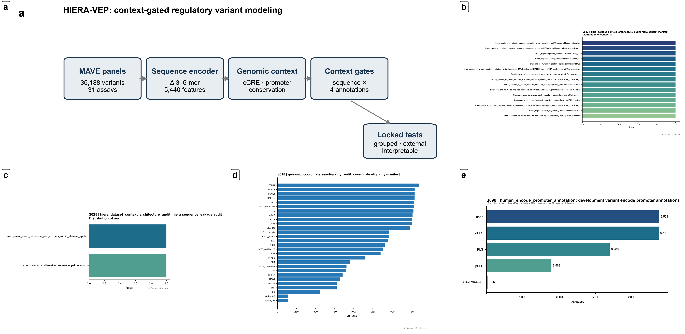
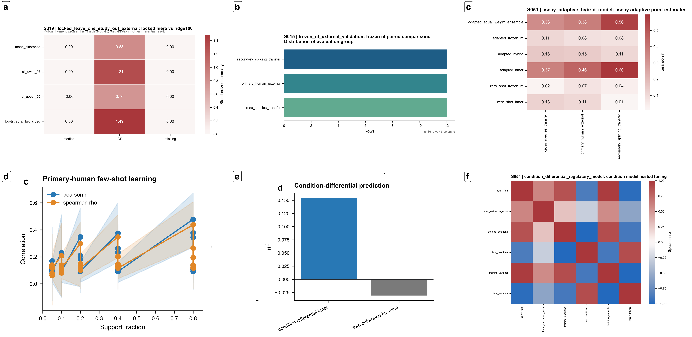
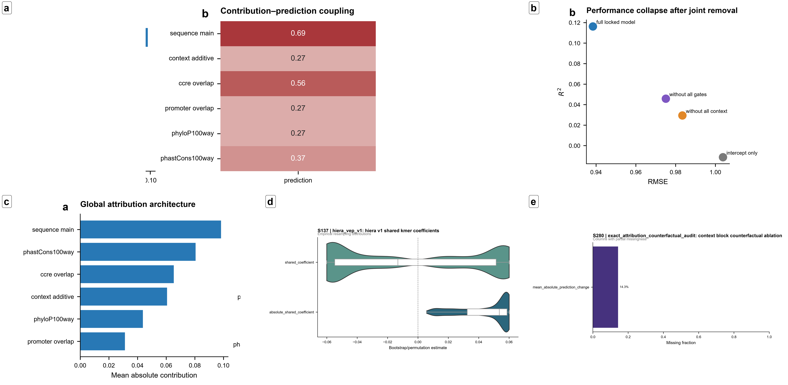
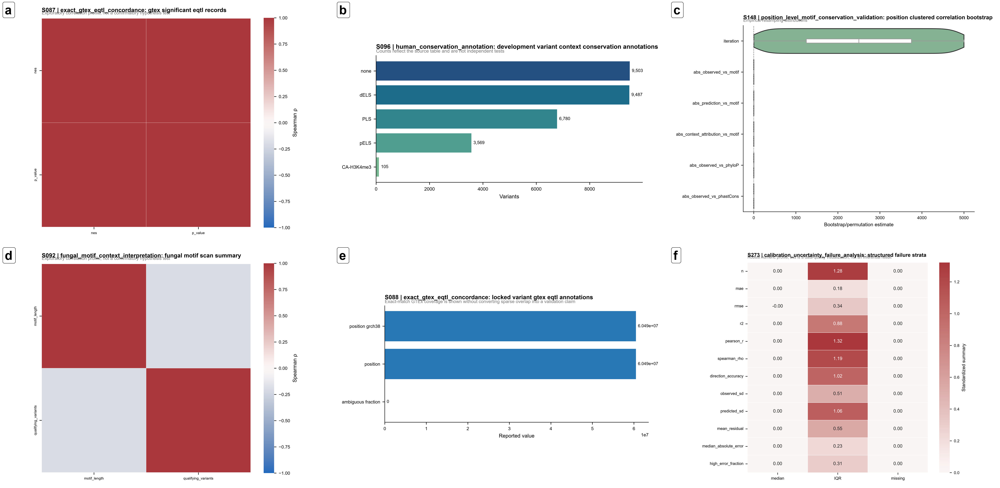

# Selected final manuscript figures

Original curated manuscript PNGs are displayed below. Step 57F assembles pre-existing panels; exact panel origins are in [CURATED_FIGURE_CAPTIONS.md](CURATED_FIGURE_CAPTIONS.md). Inputs below list principal result evidence, not a claim that composites can be reconstructed from summary tables alone. Full panel archives and variant-level plotting inputs are excluded. Captions remain manuscript working captions and require final editorial review.

| Figure | Title | Generating script | Principal input results | Interpretation |
|---|---|---|---|---|
| 1 | Study design and data architecture | src/figures/57F_curated_redesign_final_figures.py | hiera_unified_dataset_manifest.tsv; element_encode_promoter_summary.tsv | Grouped design and explicit genomic context |
| 2 | Locked predictive evaluation and comparative performance | src/figures/57F_curated_redesign_final_figures.py | locked_context_point_estimates.tsv; context_vs_sequence_paired_comparison.tsv; context_vs_nt_paired_comparison.tsv; locked_ablation_point_estimates.tsv; calibration_deciles.tsv | Modest locked improvement; compressed predictions remain |
| 3 | External transfer, adaptation and condition dependence | src/figures/57F_curated_redesign_final_figures.py | locked_external_point_estimates.tsv; frozen_nt_paired_comparisons.tsv; assay_adaptive_point_estimates.tsv; few_shot_learning_curve_summary.tsv; condition_model_point_estimates.tsv | Weak heterogeneous zero-shot transfer; adaptation is secondary |
| 4 | Exact model interpretation and feature dependence | src/figures/57F_curated_redesign_final_figures.py | attribution_block_summary.tsv; context_block_counterfactual_ablation.tsv; locked_ablation_point_estimates.tsv | Algebraic attribution and feature dependence, not causal effects |
| 5 | Biological concordance and model limitations | src/figures/57F_curated_redesign_final_figures.py | motif_conservation_validation_summary.json; gtex_eqtl_concordance_summary.json; structured_failure_strata.tsv | Sparse concordance and documented failure modes |

Selected supplementary composites S1–S4 use the same assembly script and the panel-level caption provenance. No TIFF, exploratory duplicates, or raw panel archives are bundled.
